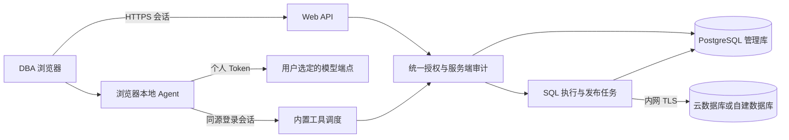

# 架构设计

## 访问路径

采用 B/S。建议用 Rust（Leptos/WASM）实现浏览器客户端，CodeMirror 负责编辑器交互。工作台与管理后台共用同一站点和登录会话。ECS 上的 Rust 服务（建议 Axum）提供静态资源及应用专用 HTTPS API。无需安装桌面程序。

**部署单位**是一台能到达目标库的 ECS。沿用 db_mcp_server 的 Compose 拉镜像、挂载配置与持久目录、健康检查和重启方式。发布时固定镜像版本。可使用已有 PostgreSQL 管理库，单机试点也可随 Compose 启动管理库并挂载数据卷。备份管理库及独立保存的凭据加密密钥，升级前备份并验证恢复。

阿里云、华为云及自建机房分别登记私网地址。单 ECS 跨网络访问的前提是已有 VPN、专线或对等路由、DNS 及安全组放行。相互隔离的网络先各自部署独立实例，账号和审计按实例管理。若要求跨云统一登录和审计，首期选用私网互通拓扑。上线验收从容器内验证实际库的 DNS、端口和 TLS。

## 身份与执行

管理员登记连接、环境（测试或生产）及数据库身份；同一物理库可登记读、写两种数据库身份。账号密码经慢哈希存储，浏览器使用安全会话 Cookie，写请求校验 CSRF。连接口令用服务端挂载密钥加密，连接列表只返回显示名、环境、类型和允许动作。

授权主体是 DBA 账号，粒度是连接及动作（读、数据写、结构变更、生产发布）。Admin 可按账号和连接授予内置 Agent 工具子集，每次调用取当前账号权限、连接能力与工具授权的交集。测试写入和生产发布均由 DBA 在工作台发起。管理权限独立于目标库执行权限。

浏览器按连接打开标签页，服务端按连接身份隔离连接池。一次脚本顺序占用同一数据库会话，事务、临时表和逐条结果均在该会话内有效。跨请求显式事务使用绑定用户、连接及标签页的短期会话，到期回滚并释放。只读使用数据库只读身份；限制写操作时结合方言解析和数据库 GRANT，无法判定的语句拒绝。生产连接的交互和 MCP 使用只读身份，发布任务使用单独受限写身份，避免绕过发布。结果分批传回，服务端限制耗时、行数及并发；取消请求须校验所有者并传至驱动。

## 管理数据与接口

| 数据 | 关系与用途 |
| --- | --- |
| user、session、connection、grant | grant 关联用户与连接；connection 保存环境、方言、加密凭据 |
| agent_tool_grant | 用户、连接、工具三元组唯一；撤权从下一次调用生效 |
| script、revision | script 归属用户；revision 保存父版本、正文、作者、时间及内容摘要。按父版本做并发校验 |
| test_run、release、release_step | 关联不可变版本、测试和生产连接、操作者、执行顺序及状态。发布请求幂等键唯一 |
| audit_event | 记录请求号、操作者、入口、Agent 运行号与工具调用号、连接、环境、语句摘要、脱敏 SQL、时间、行数、结果和错误类别；不记结果集或口令 |

接口按资源划分：登录与退出、我的连接与元数据、执行与取消、Excel 预览与提交、个人脚本与版本、测试记录与发布、后台授权与审计。任何通过 ID 访问资源的请求均在服务端核验归属。执行前持久化审计开始事件，失败则拒绝下发；执行后追加结果。进程中断留下待核查记录，不能将缺失回执解释为执行失败。后台可按人、连接、时间和发布号查询，普通账号不能修改审计。

## 从测试到生产

DBA 保存脚本生成版本，选测试库执行；服务端记录版本、摘要和每条语句结果。发布页只允许选择该账号有发布权限、与测试连接预先配对且方言一致的生产目标。确认页展示目标、版本、相对上次发布的差异和完整 SQL。确认后重新鉴权，锁定版本字节，按生产目标串行执行。修改草稿必须生成新版本并重新测试。

能在事务内执行的变更整批提交；MySQL 隐式提交 DDL 等按步骤记账。失败即停止，展示已完成、失败及未执行步骤。执行中失联标为“待核查”，DBA 对照目标库确认后另建修复版本。重复提交返回原任务；不自动重放。首期在管理库存线性版本和差异，满足个人历史与发布追踪，无需另运维 Git 服务。

## 参考依据

| 本地项目及入口 | 本方案取舍 |
| --- | --- |
| dbx：README.zh-CN.md 的查询编辑器、数据网格、导入导出，crates/dbx-formats/src/xlsx_export.rs | 作为 DBA 工作台功能基线，保留 SQL 和 XLSX 主路径 |
| db_mcp_server：docker-compose.yml、README.md 的连接级权限模型、src/security、src/mcp | 沿用部署和集中凭据思路，保留公司既有外部 AI 接入服务的独立部署边界 |
| dbflux：crates/dbflux_core、dbflux_driver_mysql、dbflux_driver_postgres、dbflux_audit | 借鉴驱动和审计分工，首期单服务部署 |
| Rustable：src/query_library.rs、src/query_history.rs、src/review_sql.rs | 参考个人脚本、历史和执行前审阅交互，持久化移到服务端 |

## 工作台与独立 Admin

参考 racewong 的 app/src/ui.rs（top_bar、status_bar、logs）及 app/src/style.rs（Palette）。浏览器顶栏放当前连接、环境及运行/取消；左栏显示获权连接与对象树，中部是 SQL 标签页，下方是可调整高度的结果区。底部状态栏给出执行状态、行数、耗时，展开可看本次执行消息。沿用明暗主题、中性灰表面、红色主操作和低饱和蓝链接；生产目标同时显示“生产”文字，避免单凭颜色判断。

管理员从 /admin/login 进入独立的 /admin 管理界面。与工作台共用身份存储，服务端对 /api/admin 下每项操作校验管理员角色。登录后默认进入连接列表，通过左侧导航维护连接、账号、连接授权、内置工具授权、审计。连接详情可测试连通性、更新凭据和设定测试/生产配对；账号详情可重置密码、停用会话并查看有效授权；授权页支持从账号查看连接、从连接反查账号。管理员可禁用某个账号在指定连接上的 Agent 工具。管理员变更动作记录对象、操作者、时间和脱敏前后值。部署时一次性创建首个管理员，避免默认密码。

## 本地 Agent 的执行边界

“本地”指 Rust/WASM 工作台中的编排循环。模型推理位置由 DBA 选择的服务商决定。用户在个人设置中填服务地址、模型和 Token，连接测试分别报告认证、模型可用性、浏览器跨域限制及工具调用支持。第一版采用 OpenAI 兼容的流式聊天和结构化工具调用协议；自托管模型可配置符合该协议的 HTTPS 端点。该端点须允许工作台源的 CORS 请求，包括 Authorization 头。切换端点须重新输入 Token；Token 默认仅驻留当前页面内存，退出、刷新后清除，个人非敏感设置可按账号保存在浏览器。禁用跨域重定向，不把 Token 发往 ECS。

1. DBA 在当前标签打开 Agent，选择当前 SQL 或输入任务，界面展示目的模型、连接、环境和将发送的上下文。默认提供选区及方言；额外表结构须在当前连接授权范围内选择。指令和元数据可能发送到用户选定的服务商。
2. 模型可给出 SQL、解释错误或请求内置工具。工具目录来自服务端，按引擎和授权裁剪。关系库支持对象、列、只读查询、非执行型计划；MongoDB 支持集合列表与受限 find；Redis 支持游标扫描及按类型限量读取。数据库文本和工具结果作为数据传入模型，不能指定新工具或扩大授权。
3. 浏览器经同源 POST /api/agent/tool-calls 提交运行号、调用号、当前连接、工具与参数；服务端从会话取用户，检查授权、环境及参数，使用受限身份执行。只读查询要求单条、方言可判定且无副作用；Mongo 和 Redis 用结构化参数和命令白名单。按调用号去重并审计。仅 dbwong 内置目录可分派，无通用 MCP 监听器、外部客户端注册或个人 MCP 密钥。
4. 工具结果先回到浏览器。凡含行数据、文档或键值，发送前展示样本和目的地，由 DBA 确认；拒绝后仅返回状态、行数或错误类别。Agent 面板按调用号更新步骤，展示运行、取消、拒绝及失败。达到轮数、大小或时间上限时停止；取消同时中止模型流、禁止下一轮并请求服务端取消在途读取。
5. 生成脚本以差异预览写入编辑器草稿。执行、Excel 导入、保存版本、发布均沿用工作台原有权限与审计。模型超时、无工具能力或 token 失效不影响手工开发；不支持工具的模型仍可生成草稿。服务端审计覆盖数据库访问；浏览器直连模型的聊天不构成服务端数据库执行记录。

## 首期驱动契约

服务端适配器返回引擎、可用动作、对象类型、分页游标、取消能力及数据类型。界面以服务端能力表与当前授权交集呈现入口，服务端独立复核。取消在驱动无法确认时显示“取消待确认”。SQL 会话、事务和发布规则适用于下表前三行。

| 引擎 | 对象及查询 | 写入、Excel、发布验收边界 |
| --- | --- | --- |
| MySQL | database、表、索引、SQL、EXPLAIN | 事务表编辑及 XLSX；隐式提交 DDL 分步记账 |
| PostgreSQL | database、schema、表、索引、SQL、EXPLAIN | XLSX、DML 和事务型 DDL；不兼容事务的语句单独处理 |
| SQL Server（MSSQL） | database、schema、表、索引、T-SQL、多结果集、估计执行计划 | XLSX、DML/DDL；脚本执行器识别独占行 GO（排除注释及字符串），批次复用会话，错误定位回原脚本 |
| MongoDB | 数据库、集合、索引，使用结构化 find 的过滤、投影、排序和限量分页；展示 BSON 类型 | 首期只读浏览与查询；不开放 JS shell、Excel 写入或 SQL 发布 |
| Redis | 选择获权逻辑库、SCAN 游标、键类型与 TTL；字符串及集合类按类型限量读取 | 首期只读；键过期按已失效展示；不提供全量阻塞扫描或 SQL 发布 |

关系库共同验收 R04–09。MongoDB、Redis 按各自的读取路径验收，保留账号、Agent 和服务端审计；普通读操作只回传当前页。Excel 完整导出及导入首期面向三个关系库。

上游提交、代码行号及对应设计用途见 [仓库源码导航](../AGENTS.md#源码导航)。
